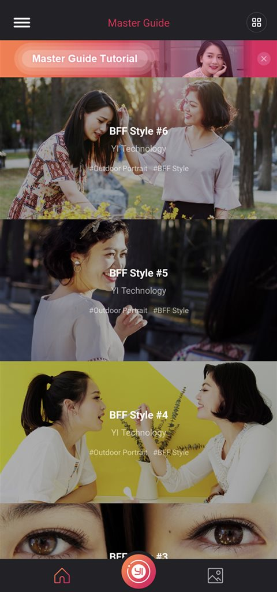
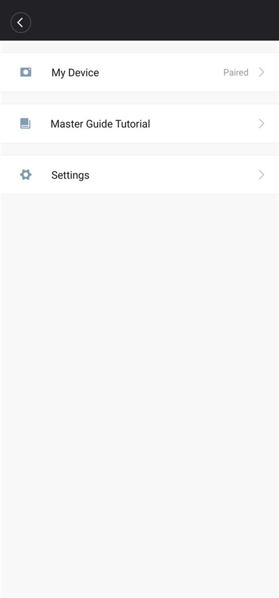
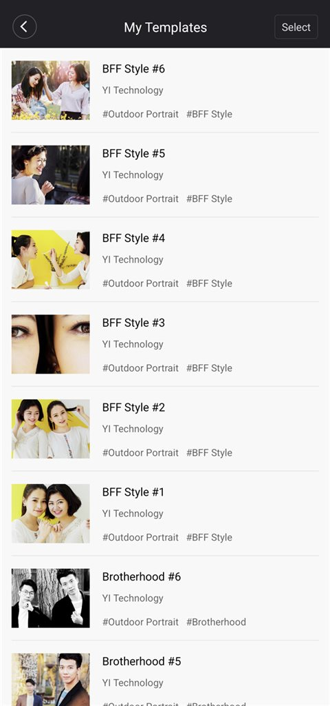

# YI Mirrorless 3.1.6 — patched for modern 64-bit Android

## **This repo is all AI assist, I only guide it along** 

An unofficial, community re-build of the discontinued **YI Mirrorless** Android app for the
**YI M1** mirrorless camera. The original 3.1.6 release (May 2019) only ships 32-bit
`armeabi-v7a` native libraries, so it cannot be installed on any phone that is arm64-only
(which is most phones since ~2021). This build removes the native dependency, replaces the
missing pieces with pure Java, and makes the app usable again.

| Master Guide | Menu | My Templates |
|---|---|---|
|  |  |  |

## Download

| File | Size | SHA-256 |
|---|---|---|
| [`apk/yi-3.1.6-patched.apk`](apk/yi-3.1.6-patched.apk) | 41.9 MB | `16CB5D67568413131CBC3F71EF0168F7627EA1D30DB16962B2B2EA8D752EE2FE` |

- Base version: **3.1.6 (2019-05-17)**
- `minSdkVersion` 19, `targetSdkVersion` 28, v1 + v2 + v3 signed
- Tested on **Android 16 (API 36), arm64-v8a only** (`ro.zygote = zygote64`)

The APK is signed with the project's own key, so the old app must be **uninstalled** before
installing this one, and the camera has to be **paired again**. See [Install](#install).

## Why a patch is needed

The original APK fails to install on arm64-only phones:

```
Failure [INSTALL_FAILED_NO_MATCHING_ABIS: Failed to extract native libraries, res=-113]
```

Simply deleting `lib/armeabi-v7a/*.so` is not enough: live view is decoded by `libframerecv.so`
and Fresco (the image loader used by every screen) allocates its encoded-image buffers through
`libimagepipeline.so`. Both had to be replaced with Java implementations.

## What works

- **Live view** with live ISO / shutter / aperture / battery values (~6–14 fps over UDP)
- **Camera control** (shutter, exposure, drive mode, …)
- **Camera album** with thumbnails for RAW (`DNG`) and RAW+JPG tiles
- **Download** from the camera (JPG, DNG) with generated DNG previews + thumbnails
- **Local album** and the full-screen viewer
- **Master Guide** (27 templates) — **fully offline**, no YI account, no CDN
- **Upload to Camera** for guide templates
- **My Templates** — browse / select / upload the templates you have, logged out

## What does not work

- The **photo editor**, GPU filters and animated GIF export need the 32-bit native libs and are
  not usable on arm64-only phones. (They are still in the APK and may crash if invoked.)
- Cloud features (login, YI Store, notifications, shares) — the servers are gone.
- "Buy Now" on paid guide templates — a purchase cannot complete without an account.

## Install

1. Uninstall the old YI Mirrorless app (the signature differs).
2. Install the patched APK:

   ```powershell
   adb install -r --no-incremental apk\yi-3.1.6-patched.apk
   ```

3. Open the app and pair the camera again (power on the M1, enable Bluetooth + Wi-Fi + Location,
   *Start Pairing*, then press **Accept** on the camera).
4. Wait for the phone to join the camera's Wi-Fi hotspot (`YI_M1_XXXXXX`); live view should
   appear within a few seconds.

## What was changed

| # | Change | Where |
|---|---|---|
| 1 | Removed all 8 `armeabi-v7a` native libraries | `lib/` (deleted) |
| 2 | Replaced the native live-view receiver with a pure-Java UDP reassembler | `LiveView.smali` + new `UdpJpegReceiver` |
| 3 | Replaced Fresco's native-memory chunk with a Java-heap chunk (same obfuscated API) | new `NativeMemoryChunk` |
| 4 | `System.loadLibrary` is now best-effort (`catch Throwable`) | `imagepipeline/nativecode`, `GifDrawable`, `PicEdit`, `GPUImageNativeLibrary` |
| 5 | `targetSdkVersion` 26 → 28 | `apktool.yml` |
| 6 | `usesCleartextTraffic` + `requestLegacyExternalStorage` | `AndroidManifest.xml` |
| 7 | Proper DNG preview extractor (IFD/JPEG scanner instead of a hard-coded offset) | new `DngJpegScanner` + rebuilt `YiMirrorlessDNG` |
| 8 | Camera album: fill in missing RAW thumbnails | `YiCameraThumb` + `AlbumItem` / `DownloadAlbumItem` |
| 9 | Master Guide works without a YI account (client-side gates + `user_id=""`) | `MasterLearn*`, `db/a`, `CameraMasterLearnActivity$3` |
| 10 | All 27 guide templates baked into the APK and seeded on first launch | `assets/offline_ml` + `OfflineMasterLearn` |
| 11 | Hamburger icon; account header + Notifications / YI Store / Instructions / FAQ removed | `action_bar_layout_main_activity.xml`, `activity_settings.xml` |
| 12 | "My Templates" opens without login and reads the local database | `MainActivity$14`, `MyMasterLearnActivity` |

### Live view: native → Java

The app already contained a Java receive loop (`LiveView$a.run()`), so only the transport had to
be replaced. The camera sends datagrams to UDP **54321**; each has a 12-byte big-endian header
`(frameIndex, packetCount, packetIndex)` followed by the payload. A complete frame is
**2048 bytes of JSON metadata + a JPEG**, max 0x19000 bytes. `UdpJpegReceiver` reassembles the
packets, copies the frame into `LiveView.mCopyArray`, sets `mArrayLength` and clears
`mCanCopy`; the untouched render thread decodes the JPEG with bitmap reuse.

`startRecvLib` / `stopRecvLib` keep their original signatures and call sites, so nothing else in
the app changed. Firmware older than 3.2 (large single-packet mode) keeps using the app's
original Java path.

### Fresco: why every image was blank

The first Java-heap `NativeMemoryChunk` had the two obfuscated accessors swapped. In the original
class:

| smali | native call | meaning |
|---|---|---|
| `a(I[BII)I` | `nativeCopyFromByteArray` | **write** — `byte[]` → chunk |
| `b(I[BII)I` | `nativeCopyToByteArray` | **read** — chunk → `byte[]` |

With them swapped, every decode read a zero-filled buffer: a valid 6.5 kB JPEG was fetched and
then rejected with `IllegalArgumentException: unknown image format`. That is why *every* picture in
the app (camera tiles, local tiles, viewer) was blank while BLE, HTTP control and downloads worked.

### RAW (DNG) previews

The original `YiMirrorlessDNG` never parsed the file: it sliced a hard-coded 1.25 MB window
(offset `0x34B00`, length `0x138800`) and wrote it out as a `.JPG` without checking whether it was
a JPEG. `getThumbData()` used IFD0 tags `0x0111`/`0x0117`, which point at the raw sensor strip.
That only worked for one firmware layout.

The replacement:

- `DngJpegScanner` walks IFD0, SubIFDs and the next-IFD chain for the standard DNG preview
  pointers `0x0201`/`0x0202` (and JPEG-compressed strips), falls back to the legacy fixed window,
  then to a linear SOI/EOI scan.
- `YiMirrorlessDNG` validates every candidate with `BitmapFactory` and keeps the first one that
  really decodes; the preview is written byte-for-byte, the thumbnail is decoded with
  `inSampleSize` and re-encoded at 88 % quality. If nothing decodes it returns `false` and the
  downloader drops the item instead of registering a broken image.

Verified against a real YI M1 DNG (`raw.pixls.us`, `YI TECHNOLOGY/M1/PC070001.DNG`, 31.9 MB):
preview `3200x2400` byte-identical to the embedded JPEG, thumbnail `800x600`.

**Where RAW previews appear**

- *Camera* album: every tile uses the camera's own 160x120 JPEG (`GET /?data={...GetFile...Thumbnail}`),
  which Fresco caches. `YiCameraThumb.fix()` fills in the URL for items that arrive without one.
- *Local* album: after download the app generates `dng_preview_/` and `dng_thumb_/` and shows them
  in the grid and the viewer.

### Master Guide without a YI account

The guide was gated three ways: list/detail required a logged-in user, the template download
endpoint returned `20302` for guests, and the camera upload queue aborted without a user. Client-side
smali patches remove those gates and the whole path runs as a guest (`user_id=""`):

| File | Patch |
|---|---|
| `MasterLearnDetailActivity.t()` | login gate → `goto` (never opens `LoginActivity`) |
| `MasterLearnDetailActivity.a(Map)` | ignore the server `isDown` flag |
| `MasterLearnDetailActivity.r()/u()` | use `user_id=""` instead of `l.a.userId` |
| `db/a.a(Map,Map,String)` | early return removed; rows are written with `user_id=""` |
| `CameraMasterLearnActivity$3` | guest abort → continue into the upload queue |
| `db/a.e(String)` | return the downloaded-template map for an empty user id |
| `MasterLearnDetailActivity.onResume()` | reload that map, so "Upload to Camera" sticks |

The paid "Buy Now" path is untouched: only the free templates are unlocked.

### Offline Master Guide

The catalog no longer needs a server — all 27 templates ship inside the APK:

- `assets/offline_ml/catalog.json` — list entries (English text, exposure parameters, `asset:///` URIs)
- `assets/offline_ml/g/<downFileName>` — the guide JPG that is uploaded to the camera
- `assets/offline_ml/i|p|x/<picId>.jpg|png` — list preview, detail picture, shadow overlay
- `OfflineMasterLearn.java` — copies each guide JPG to
  `getExternalFilesDir("masterlearn")/<downFileName>`, writes the `master_learn_detail` /
  `master_learn_detail_item` rows through `db/a.a(Map,Map,String)` with `user_id=""`, and appends
  the entries to `common/l.d`.

Smali hooks: `MasterLearnFragment.onResume()` calls `OfflineMasterLearn.load()` after
`b/e.a(Context)`; `h()` / `j()` (list refresh + load-more) are no-ops; the endless-scroll footer is
disabled; `db/a.d()` (which wipes the cached detail table on a locale change) is a no-op so the
seeded rows survive.

### Side menu and My Templates

- The top-left person icon is now a hamburger (`home_hamburger.png`).
- The menu it opens (`SettingsActivity`) hides the avatar / login block and the
  **Notifications**, **YI Store**, **Instructions** and **FAQ** rows. Only **My Device**,
  **Master Guide Tutorial** and **Settings** remain. The hidden views stay in the layout with
  `visibility="gone"`, so the existing activity code (which looks them up) keeps working.
- The top-right grid icon opens **My Templates** for guests too: the login gate in
  `MainActivity$14` and the guest `finish()` in `MyMasterLearnActivity.onResume()` are bypassed.
  The screen reads the local database (`user_id=""`), so it lists every bundled template, opens
  the normal detail page (with **Upload to Camera**) and offers multi-select upload/delete.

## Build from source

Everything needed to reproduce the APK is in [`build/`](build). The original APK is **not**
included (it is YI's copyrighted binary); download the 3.1.6 release from a mirror and check that it is the right base:

```
SHA-256  2B73F7805DFCB3BDE0EFBE3F8286958BA849AB614317E9C0814985EA8F927001
```

Requirements:

- Windows PowerShell 5.1+ (PowerShell 7 works too)
- JDK 11+ (`JAVA_HOME` or `-JavaHome`)
- Android SDK with `build-tools` and at least one platform (`ANDROID_SDK_ROOT` / `ANDROID_HOME`
  or `-AndroidSdk`)
- apktool 3.0.3 and baksmali 3.0.10 — bundled in `build/tools`

```powershell
cd build

# signed (recommended)
.\build.ps1 -OriginalApk "C:\downloads\YI+Mirrorless_3.1.6.apk" `
            -Keystore "C:\keys\my-release.jks" -StorePass "********" `
            -KeyAlias "mykey" -KeyPass "********"

# or unsigned, then sign it yourself
.\build.ps1 -OriginalApk "C:\downloads\YI+Mirrorless_3.1.6.apk"
```

The script:

1. decodes the original APK with apktool into `build/.work/decoded`
2. copies the patch set from `build/decoded-patch` (smali + layouts + manifest + `apktool.yml`)
3. deletes `lib/`
4. compiles the Java replacements from `build/patch-src` and baksmali's them into the tree
5. copies `build/assets/offline_ml`
6. rebuilds with apktool, zipaligns and signs → `build/out/yi-3.1.6-patched.apk`

No keystore is shipped with this repo. If you build with your own key, that APK will not install
over the release APK — uninstall first (the same applies in reverse).

### Repository layout

```
apk/yi-3.1.6-patched.apk     release binary
build/
  build.ps1                  full reproducible pipeline
  decoded-patch/             hand-edited smali, layouts, manifest, apktool.yml
  patch-src/                 pure-Java replacements + compile stubs
    tools/fetch_offline.py   re-downloads the guide catalog/images (optional)
    test/DngScannerTest.java desktop tests for the DNG scanner
  assets/offline_ml/         27 baked guide templates
  tools/                     apktool 3.0.3, baksmali 3.0.10
docs/                        screenshots
```

## Verified on a real device

- Installs and launches on Android 16 (API 36, arm64-only), no crash.
- BLE pairing completes, the app joins the camera Wi-Fi, no `SecurityException`.
- Live view renders the UDP stream at ~6–14 fps with live exposure values.
- Camera album lists ~60 files and every RAW / RAW+JPG tile shows a thumbnail.
- A 31.9 MB DNG downloads, gets a 3200x2400 preview + 800x600 thumbnail, and opens in the viewer.
- Shutter release writes JPG + DNG to the card; both can be downloaded and appear in the Local album.
- Master Guide opens without an account, uploads "BFF Style #5" and "#6"; the camera's
  *Camera Templates* screen gained the corresponding tiles.
- With airplane mode on (no Wi-Fi, no mobile data) a cold start lists all 27 templates with
  pictures, and the detail pages render and offer **Upload to Camera**.
- The menu shows only *My Device*, *Master Guide Tutorial* and *Settings*.
- **My Templates** lists all 27 templates and opens the detail page, logged out.

## Known limitations

- Photo editor / GPU filters / animated GIF need the 32-bit native libs — not usable on arm64-only
  phones. You may want to avoid those buttons.
- Re-signing means a one-time uninstall + re-pair; the old key is not recoverable.
- Push/notification services (Xiaomi push, Mob, Umeng, Facebook, Bugly) are dead and only generate
  startup network noise.
- **My Templates → Delete** still asks the YI server to unregister the template, so it only works
  online. **Upload to Camera** is local and works offline.
- Camera-side RAW tiles use the camera's 160x120 JPEG preview, so they look soft in the grid; the
  3200x2400 preview is only generated after a download.
- If a DNG has no embedded JPEG, no preview is produced and the item is dropped from the gallery
  rather than showing a broken image.

## Legal

This is an unofficial patch, not affiliated with or endorsed by YI Technology. The original app is
discontinued and no longer distributed by its vendor. The patch exists so that owners of the
hardware can keep using a camera they already own. No original APK is redistributed here; the
patched APK contains the original application code and is provided as-is, without warranty of any
kind. Use at your own risk.
